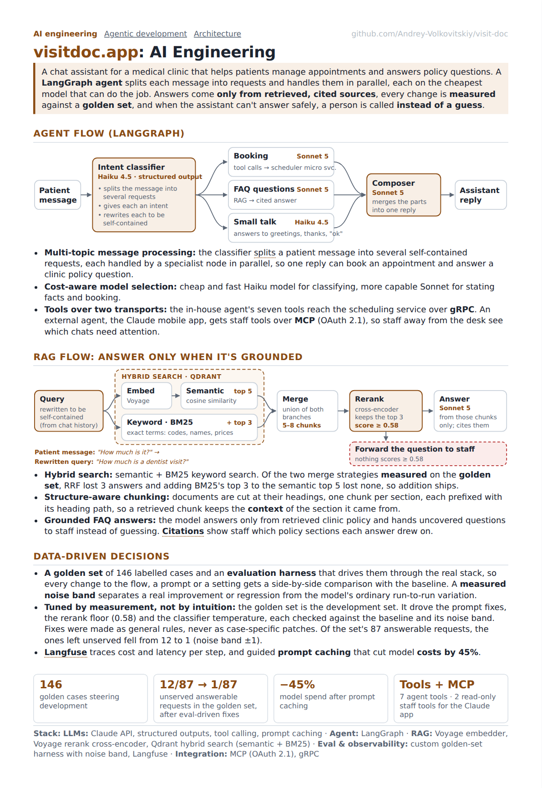
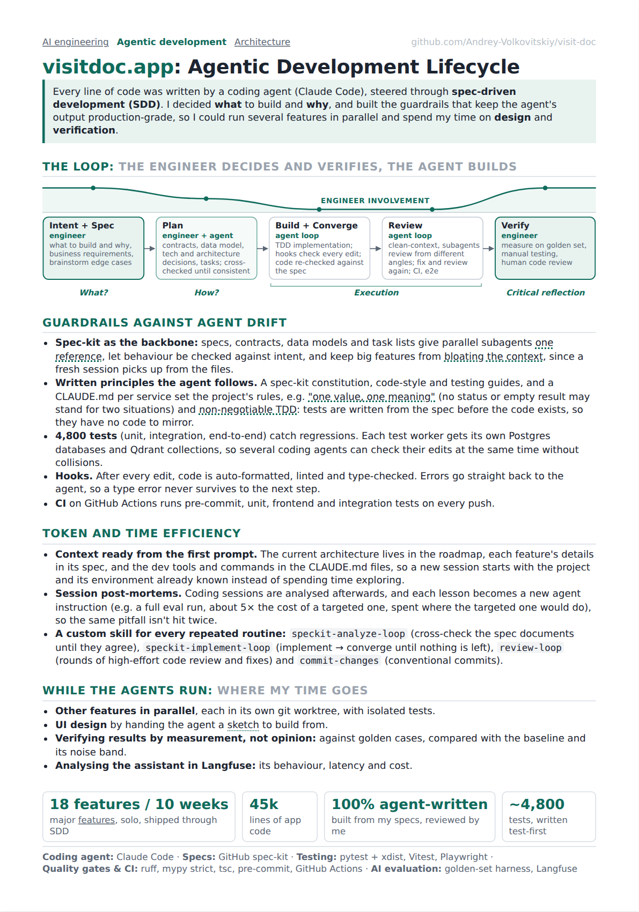
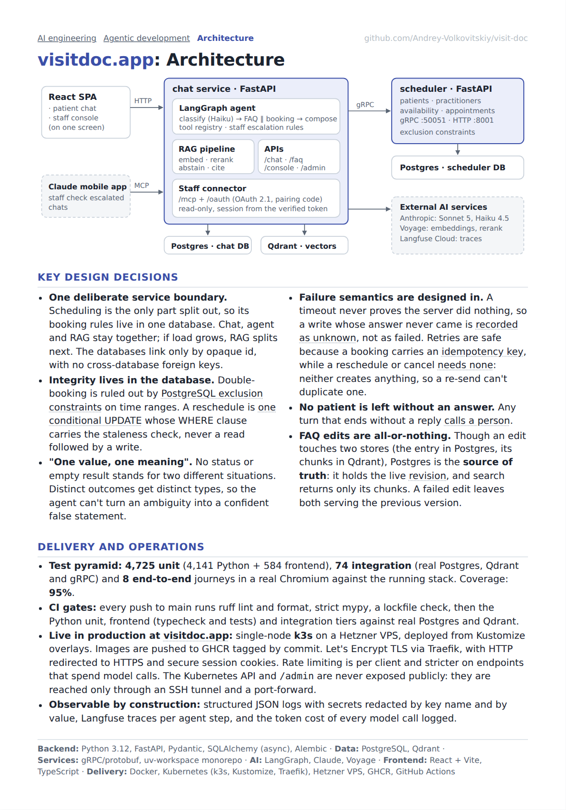

## Hi, I'm Andrey 👋

**AI Engineer** with a 3 years background in backend Python development. I build conversational AI
assistants for healthcare: LLM agents, RAG, and the evaluation that shows they can be trusted.

📍 Belgrade, Serbia · open to work  
📫 [Email](mailto:andrey.volkovitskiy@gmail.com) · [Telegram](https://t.me/andrey_volkovitskiy) · [LinkedIn](https://www.linkedin.com/in/andrey-volkovitskiy)  
📄 [CV (Resume)](./--CV--.pdf)

---

### 🛠 Stack

- **LLMs & agents:** Claude API · OpenAI API · LangGraph · tool calling · structured outputs · prompt caching · MCP
- **RAG:** Qdrant · hybrid search (dense + BM25) · Voyage embeddings and rerank
- **AI evaluation & observability:** golden-set eval harness · Langfuse tracing
- **Backend:** Python · FastAPI · AsyncIO · Pydantic · PostgreSQL · SQLAlchemy (async) · Redis  · gRPC
- **Delivery:** Docker · Kubernetes (k3s) · GitHub Actions · Pytest · mypy
- **AI-assisted development:** Claude Code · Codex · spec-driven development (spec-kit) · custom skills and hooks

---

### 🩺 Portfolio project

**VisitDoc - an AI clinic receptionist**

**[Live demo ↗](https://visitdoc.app)** (no sign-up) · **[Repository ↗](https://github.com/Andrey-Volkovitskiy/visit-doc#readme)** · Sep–Oct 2026

A chat assistant that books, reschedules and cancels clinic appointments and answers policy/FAQ
questions with citations. When it can't answer reliably, it hands the conversation to staff
instead of guessing.

https://github.com/user-attachments/assets/d022c3f5-3596-4b5f-910f-ba716d667c42

- **Agent:** a LangGraph flow on Claude that splits mixed-intent messages across parallel specialist nodes and merges their answers
- **RAG:** hybrid retrieval on Qdrant (Voyage embeddings + BM25, Voyage rerank) with citations, plus an abstain-and-escalate path
- **Evaluation:** a 146-case golden set, comparing every change against a committed baseline and the measured run-to-run noise. Langfuse traces each step
- **Architecture:** FastAPI services talking over gRPC, a booking service whose PostgreSQL constraints rule out double-booking, a React chat UI and staff console, an MCP connector for staff
- **Deployment:** Docker, then Kubernetes (k3s) on a VPS

Each of these one-page overviews looks under its hood from a different angle: the **AI engineering**
behind the assistant (agent flow, RAG, evaluation), the **agentic development lifecycle** it was
built with, and the system **architecture** that runs it in production.

<table>
<tr><th width="33%"><a href="https://andrey-volkovitskiy.github.io/visit-doc/portfolio-ai-engineering.html">AI Engineering</a></th><th width="33%"><a href="https://andrey-volkovitskiy.github.io/visit-doc/portfolio-adlc.html">ADLC</a></th><th width="33%"><a href="https://andrey-volkovitskiy.github.io/visit-doc/portfolio-architecture.html">Architecture</a></th></tr>
<tr><td></td><td></td><td></td></tr>
</table>

---

### 💼 Background

- **2024 – 2026 · AI Engineer** at [MIEA Health](https://mieahealth.com/)  
  Built a multitenant AI assistant for Singapore private clinics: LangGraph, tool calling, RAG, LLM-as-a-judge
- **2023 – 2024 · Backend Developer** at Filegaroo  
  Built a FastAPI service and its Pytest suite; cut response time 40% through code and DB tuning
- **2022 – 2023 · Professional Retraining**  
  Comprehensive backend engineering training at Hexlet and Yandex
- **2012 – 2022 · Avalanche Safety Educator & Mountain Guide**  
  Translated and published 4 [books](https://snowsense.ru/bookslide/kniga-bezopasnost-v-zimnih-gorah-staying-alive-2019/), 2 protocols for deciding under uncertainty
- **2003 – 2011 · Senior Pre-Sales Engineer**  
  Designed VoIP and call-center solutions for major banks and telcos (T-Bank, VTB, MegaFon)
- **MSc, Computer Science** – [MEPhI](https://en.wikipedia.org/wiki/Moscow_Engineering_Physics_Institute)
