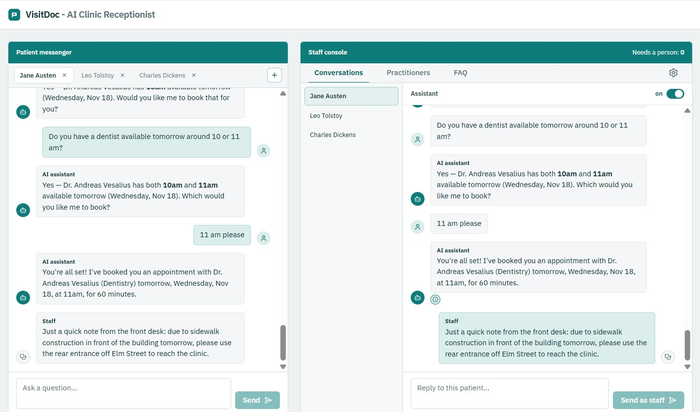
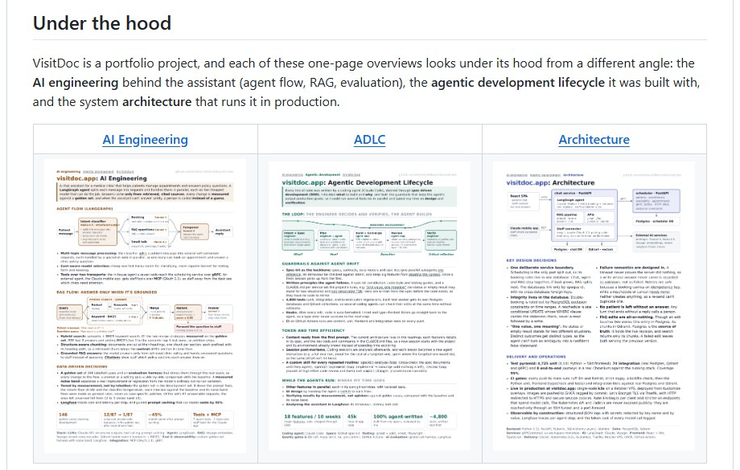

## Hi, I'm Andrew 👋

**AI Engineer** with a background in backend Python development. I build conversational AI
assistants for healthcare: LLM agents, RAG, and the evaluation that shows they can be trusted.

📍 Belgrade, Serbia · open to work  
📫 [Email](mailto:andrey.volkovitskiy@gmail.com) · [Telegram](https://t.me/andrey_volkovitskiy) · [LinkedIn](https://www.linkedin.com/in/andrey-volkovitskiy)  
📄 [CV (Resume)](./--CV--.pdf)

---

### 🛠 Stack

- **LLMs:** Claude API · OpenAI API · tool calling · structured outputs · prompt caching
- **Agents & RAG:** LangGraph · hybrid search (semantic + BM25) on Qdrant · Voyage embeddings and rerank · MCP
- **AI evaluation & observability:** golden-set eval harness with a measured noise band · Langfuse · structured JSON logs
- **Backend:** Python · FastAPI · Django · AsyncIO · Pydantic · Celery · APScheduler
- **APIs & integration:** REST · OpenAPI · gRPC/protobuf · WebHooks · WebSockets · NDJSON streaming · JWT · OAuth
- **Data:** PostgreSQL · SQLAlchemy (async), Alembic · Redis · S3
- **Testing & quality:** TDD · Pytest · mypy · ruff · pre-commit
- **DevOps:** Docker · Docker Compose · Kubernetes (k3s, Kustomize) · GitHub Actions · GHCR
- **Frontend:** React + Vite, TypeScript
- **AI-assisted development:** Claude Code · Codex · spec-driven development (spec-kit) · hooks · custom skills

---

### 🩺 Portfolio project

**VisitDoc, an AI clinic receptionist**

**[Live demo ↗](https://visitdoc.app)** (no sign-up) · **[Repository ↗](https://github.com/Andrey-Volkovitskiy/visit-doc)** · Sep–Oct 2026

A chat assistant that books, reschedules and cancels clinic appointments and answers policy/FAQ
questions with citations. When it can't answer reliably, it hands the conversation to staff
instead of guessing.

&nbsp;

- **Agent:** a LangGraph flow on Claude that splits mixed-intent messages across parallel specialist nodes and merges their answers
- **RAG:** hybrid retrieval on Qdrant (Voyage embeddings + BM25, Voyage rerank) with citations, plus an abstain-and-escalate path
- **Evaluation:** a 146-case golden set, comparing every change against a committed baseline and the measured run-to-run noise. Langfuse traces each step
- **Architecture:** FastAPI services talking over gRPC, a booking service whose PostgreSQL constraints rule out double-booking, a React chat UI and staff console, an MCP connector for staff
- **Deployment:** Docker, then Kubernetes (k3s) on a VPS

One-pagers: [AI engineering](https://andrey-volkovitskiy.github.io/visit-doc/portfolio-ai-engineering.html) ·
[Development lifecycle](https://andrey-volkovitskiy.github.io/visit-doc/portfolio-adlc.html) ·
[Architecture](https://andrey-volkovitskiy.github.io/visit-doc/portfolio-architecture.html)

---

### 📚 Earlier projects

- [task-manager](https://github.com/Andrey-Volkovitskiy/task-manager): a Django/DRF task tracker for office teams
- [queue-manager](https://github.com/Andrey-Volkovitskiy/queue-manager): a Django app that serves bank clients in order of arrival
- [web-page-analyzer](https://github.com/Andrey-Volkovitskiy/web-page-analyzer): a Flask app that checks web pages for basic SEO

Certificates: [Hexlet: Python Development](./Hexlet-certificate.jpg) (2023) · [Yandex: Algorithms Training 5.0](./algorithms_certificate_en.jpg) (2024, 38/40 problems)
